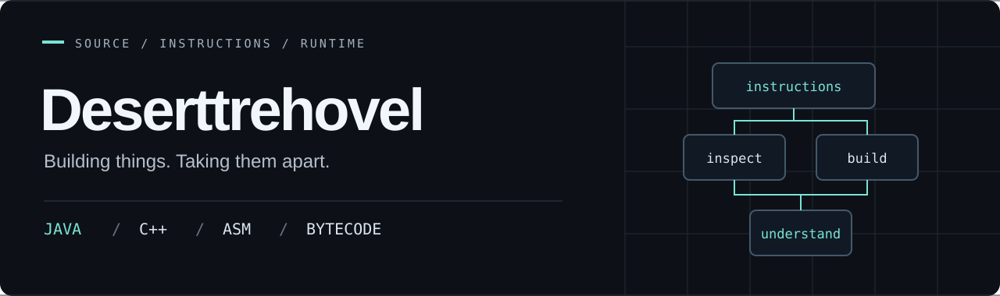

  <picture>
    <source media="(prefers-color-scheme: light)" srcset="./assets/header.svg">
    
  </picture>

  <a href="#about"><b>About</b></a>
  &nbsp;·&nbsp;
  <a href="#toolbox"><b>Toolbox</b></a>
  &nbsp;·&nbsp;
  <a href="#under-the-hood"><b>Under the hood</b></a>

 

## 01&nbsp;&nbsp;About

I build software and reverse engineer the systems behind it.

My work spans **Java, C++, assembly and bytecode**—from writing source code to tracing control flow, inspecting runtime behavior and understanding where the abstractions end.

Across more than **200 projects**, my goal has stayed the same: make the unfamiliar understandable and the difficult feel precise.

 

## 02&nbsp;&nbsp;Toolbox

| | |
| :--- | :--- |
| **SOURCE** | Java · C++ |
| **LOW LEVEL** | ASM · Bytecode |
| **ANALYSIS** | Reverse engineering · Deobfuscation |
| **FOCUS** | Control flow · Runtime behavior · Optimization |

 

## 03&nbsp;&nbsp;Under the hood

I am interested in the gap between **what source code says** and **what a program actually does**.

Sometimes that means building something. Sometimes it means taking it apart. Always, it means looking beneath the surface.

 

  <picture>
    <source media="(prefers-color-scheme: dark)" srcset="https://capsule-render.vercel.app/api?type=rect&height=70&color=0:0d1117,100:0d1117&section=footer&text=JAVA%20%C2%B7%20C++%20%C2%B7%20ASM%20%C2%B7%20BYTECODE&fontSize=16&fontColor=79e4d5&animation=fadeIn">
    
  </picture>

